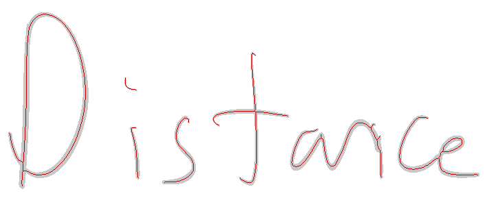

# Feasibility check on `Multivariable Calculus.pdf` (GoodNotes export, 24 pages)

- Ink is vector: page 2 has 0 images, 731 filled paths, ~86k bezier segments. 22 of 24 pages are handwritten.
- Paths are filled outlines (pressure pen), ribbons ~0.5pt wide (p10 0.27, p90 0.74). Width = pressure proxy.
- One PDF path = one pen stroke, but split into 3-10 closed sub-loops. Stroke order is preserved by draw order.
- GoodNotes embeds an invisible OCR text layer (render mode 3) with word boxes. Prose is mostly right, equations are garbage.
- Centerline recovery test on "Distance" (rasterize 600dpi + skeletonize): clean, 7 components for 8 letters, matches the real joins ("ance" is one stroke).

Open question: target documents are math or prose? Math needs its own layout + symbol work.

## Extraction + alignment results (same day)

- Extractor (`inkclone/extract.py`): per-loop opposite-point pairing -> centerline + width. Page 2 re-render vs PDF render at 600dpi: IoU 0.81, recall 0.955, precision 0.85. Whole notebook: 16,987 strokes, 2.07M samples, ~1 min.
- Alignment (`inkclone/align.py`): OCR word boxes -> stroke groups. Dictionary filter alone: 629 words, 37/48 labels correct on a random sheet (all errors = math OCR'd into short words). Adding the line-trust filter (line must be mostly dictionary tokens): 272 words, 128 distinct, 47/48 correct (`reports/contact_sheet_words_seed1.png`). Every lowercase letter covered.
- Yield is now the bottleneck: ~12 clean words per page. More notebooks scale it linearly; prose-heavy notebooks will yield far more than math ones.

## Segmentation, bank, first synthesis (same day, later)

- Corpus after adding 8 notebooks: 82 handwritten pages, 69,527 strokes, 1,249 labeled words (`scripts/run_all.py`).
- Character segmentation (`inkclone/segment.py`): DP over cut points with learned per-letter width priors. 5,112 letter instances. Measured join behaviour: 31% of adjacent pairs joined overall, "an" 85%, "er" 74%, "nd" 2%, "ed" 3"; join INTO d/b/w 3%/8%/10%.
- Style: x-height 3.9pt median (IQR 3.0..4.9), slant -4.4 deg, unjoined letter gap 0.19 xh, word gap 2.2 xh (2,007 pairs).
- Glyph bank with per-class height filter: 3,967 instances. Per-letter grid (`reports/bank_grid_aetDs.png`): only ~65-80% of instances for common letters are clean cuts, the rest carry neighbour fragments. THIS is the current quality bottleneck.
- First synthesis (`inkclone/synth.py`, `reports/compare_line_v2.png`): recognisably the same letterforms, not passable yet. Causes: dirty instances (above), pen width overestimated 0.66 vs 0.49pt (fixed in extractor: area/perimeter width), sparse capitals (D: 1 clean instance).
- Next: shape-based outlier rejection per letter, then template-guided re-segmentation (EM), then re-evaluate the grid before touching the synthesiser again.

## Capitals sheet + source-text labeling (evening)

- `inkclone/label_source.py`: labels a page from its typed source via fuzzy sequence alignment of OCR boxes to source tokens (1-2 boxes per token). Capitals sheet: 255/281 tokens matched, 244 words, 48/48 labels correct on the contact sheet.
- Segmentation DP vectorised: 211s -> 13s for the corpus.
- Corpus: 1,493 labeled words, 6,169 letter instances. Every capital has >= 4 raw instances.
- Capital filter bug: writer's capitals are 3.5-4.5 x-heights; range widened to 1.8-5.5. Capital width prior raised to 1.8.
- Whole-word outlier filter (width / stroke count vs same-word median): 1,489 -> 1,321 word instances.
- `reports/compare_line_v5.png`: whole-word lines good; assembled words improved (B, F present) but still rough. Letter cuts around capitals are the dirtiest. Next: template-guided re-cutting.
- Template-guided re-cut (`inkclone/recut.py`, vectorised, 28s for the corpus): 953/1493 words changed cuts. e/t/s grids visibly cleaner (`units_letter_grid_aets_v2.png`), "a" less so.
- Letters that are complete pen strokes (unjoined both sides) are clean by construction: 2,247 of 3,598. Synth2 now prefers them.
- `compare_line_v7.png`: whole-word lines good except occasional mislabeled word instances (an OCR "the" that is really "that"). Assembled words still inconsistent word to word.
- Template scoring of every unit (letters: 2nd-nearest template distance; words and chunks: mean letter score). Drop worst 15% of word instances (1355 -> 1166) and 219 chunks. Quality-weighted sampling in Synth2 (softmax over score, never argmin, so variation stays).
- `compare_line_v9.png`: "Shortest Paths with Few Steps", "Bellman Ford, stop when a round", "No change round means fixed point, so stopping early is safe" all readable and in the writer's hand. Still weak: "changes", "nothing" (chunk 'ng' from a poor source).

## Symbols (loop tick, ~18:40)

- `inkclone/symbols.py`: pairs handwritten lines to source lines by fuzzy match on OCR letters+digits (the writer skipped one source line, so positional pairing was off by one), then aligns ink clusters to space-separated tokens, and only cuts inside multi-char tokens.
- Result (`reports/symbols_grid.png`): `[ ] ( ) = + < ≤ ≥ ∞ ∈` and digits mostly clean; 7/8/9 perfect. Commas and the single-instance set symbols (← ∪ ∩ ∅) unreliable. Enough for a first homework page; a second short symbol line or two would fix the rest.

## Layout engine v1 (loop tick, ~19:05)

- `inkclone/source_doc.py` parses the typed PDF: front matter, numbered headers, pseudocode blocks with indentation, prose paragraphs (merged across PDF line breaks), sub/superscripts marked _ ^.
- `inkclone/page.py` lays out GoodNotes-size pages in the writer's HW conventions and renders PNG + PDF. First full `set05.pdf` rendering: `reports/page_set05_v3_p1.png`, `_p2.png`, `.pdf`.
- Reads as the writer's hand at a glance; structure correct. Weak layer = symbols/punctuation: `( ) | . , -` instances are dirty or few, `⇒ → ⇔` missing (writer draws ⇒ as "=>"), digits unreliable. Next: harvest single-stroke symbols/punctuation from the 69k unlabeled strokes by shape-matching against the few clean seeds, and compose ⇒/→ from parts.

## Symbol harvest from unlabeled strokes (~19:30)

- `inkclone/harvest_unlabeled.py`: shape-match 69k unlabeled strokes against clean seeds (single strokes and consecutive pairs), letters as negative classes, seed cleaning, all-class margin. Clean: `( [ ] , - 1 2 7 8 = ≤` (30-150 each). Poisoned by a bad lone seed and dropped: `/ 5`, tail of `≥`. Grid: `reports/harvested_grid.png`.
- `inkclone/symbols_merge.py` -> `symbols_final.pkl`. `page.py`: composites ⇒ "=>" → "->" ⇔ "<=>", ">" and ")" "]" by mirroring, "0" from whole-stroke "o".
- Ink-density filter on word instances (drops scribbled ones like the recurring "path").
- Pages: `reports/page_set05_v4_*.png`, `v5`.

## Coherence + plausibility (~20:00)

- Coherence pass (v6): per-unit slant and pen width stored at build; per line one slant (document slant ± drift) and size mood; document pen 0.49pt; affine-only shear/scale on every unit incl. symbols.
- Joins between assembled letters at measured pair rates (v7): little visible effect; kept, enabled.
- Root cause of "missing letters" in assembled words: mislabeled chunks (cutter put a run boundary at the wrong pen-up, so e.g. an "ng" chunk was really just "g"). Fix: geometric plausibility vs label (width ~ sum of letter widths, extents ~ union of letter extents) on chunks, letters, words. Dropped 298/397/173. Zoom before/after: `reports/joins_zoom.png`, per-unit view `reports/unit_debug.png`.
- Page v8: `reports/page_set05_v8_p1.png`.

## Evaluation artefacts (~20:05)

- `reports/side_by_side_hw5.png`: real HW5 page 1 (left) vs generated from set05.pdf (right), equal scale. Letterforms comparable; LAYOUT differs: the real page is two-column (pseudocode left, condensed Why/Time notes right at ~0.8x size), smaller x-height, far more whitespace. Generated is single column, full text, larger.
- `reports/pick_the_fake.png` + sealed `pick_the_fake_KEY.txt`: 24 word crops, 12 real / 12 assembled. Author's own read: ~5 fakes obvious (garbled), ~7 plausible.
- Vector export: `page_set05_eval.vector.pdf` (one filled ribbon per stroke, 4,341 paths on p1), opens as real ink.
- Next: two-column HW layout (code left, notes right, smaller), body x-height matched to HW5 (~3.6pt).

## Two-column HW layout (~20:30)

- Measured HW x-height 3.65-3.9pt (was rendering at 4.2). Body now 3.75, header 6.6.
- `page.py` sections: header, intro prose full width, code left, notes right at 0.8x starting level with the code; column split measured from the actual code width, fallback to notes-below when code is wide; overflow notes continue below.
- `reports/side_by_side_hw5.png` regenerated: structure now matches the real HW5 page (code left, small notes right, one page for the content).

## Digits, drift (~20:55)

- Seed cleaner keeps the best mutual pair when a class would be emptied. Digit grid `reports/digits_grid.png`: 0/1/2/7/8 clean, 3 and 9 a few, 4/5/6 unusable (mislabeled or poisoned) and removed from the bank. One written line of spaced digits would fix these.
- `inkclone/drift.py`: measured from 1,030 line pairs / 1,168 lines / 951 margins: pitch ratio sd 0.33 (includes paragraph gaps), baseline slope sd 0.039 pt/pt (includes math noise), margin sd 7.6pt (includes indents). Applied at a fraction with clamps: pitch N(1, 0.08) in [0.92, 1.18], slope capped ±0.012, margin jitter sd 2.7pt. First attempt at full measured variance caused line collisions.
- Code pitch 3.6 -> 3.9 xh. ')' mirrored from '(' again (harvested ')' were poor).

## CLI + HW5 from typed source (~21:20)

- `python -m inkclone.cli build|render`. Full build 2:18.
- HW5 labeled from set05 text via fuzzy alignment: 11 -> 138 words. Header words now exist whole; "1) Shortest Paths with Few Steps" renders from the writer's own header-size instances.
- Harvest is seed-sensitive run to run ('-' and '7' dropped this build). Needs stabilising (fixed seed set or union across runs).

## Generalisation test (~21:50)

- Harvest union across builds (keyed by source stroke) so classes persist.
- Parser generalised: any short bold line at body size+ is a header ("Question 1"), front matter only on page 1, standalone equation lines -> `math` display lines. Verified on set05 and on an unseen typed HW (`other_HW3`, 7 questions): full page renders, headers and prose right.
- Limits found: LaTeX fractions come out as separate numerator/denominator lines; blackboard-bold ℤ renders as Z; hyphen bank had collapsed -> hyphen now taken from one stroke of an '=' when the bank is thin.

## Fractions + rare capitals (~22:15)

- LaTeX fraction bars in these PDFs are stroked lines (m/l/S), not filled rects. `fold_fractions` now takes any thin horizontal drawing as a bar and folds the spans sitting inside its x-extent just above/below into `frac{num}{den}`; `page.fraction` renders them stacked with a bar borrowed from '='. Containment rule needed (first attempt swallowed whole prose lines).
- Rare capitals (<3 instances) default to the measured capital extent so Q/X/Y are not oversized.
- Remaining parser quirks: superscripts inside fractions lose the ^ marker; an isolated operator can be mistaken for a numerator.

## Clean-room rebuild (2026-10-07 06:12)

- `data/derived` wiped, `cli build` from raw exports + typed sources: 1,620 labeled words, 1,031 word instances / 450 distinct, 721 chunks, 3,458 letters, every capital present; both test documents rendered from scratch. Pipeline is reproducible. Build order bug (recut before its templates existed) fixed with a two-pass bootstrap.
- Harvest union starts empty on a clean tree, so the hyphen class is thin again; the '=' stroke fallback covers it.

## Where to go next (needs the writer)
1. Pick-the-fake score and what gives the fakes away (`reports/pick_the_fake.png`, key in `pick_the_fake_KEY.txt`).
2. Vector PDF import into GoodNotes (`out/set05_handwritten.vector.pdf`).
3. Data: prose/heading-rich exports (whole-word coverage, header register), one line of spaced digits (4, 5, 6).

## Pick-the-fake result #1 and the spelling bug (2026-10-07 morning)

- Writer caught 11/12 fakes (missed "grade"), and called 3 of his own words fake (Model, distance, answer). Assembled words clearly fail.
- His tell: misspellings (Dstaune, witten, drected, matri). Per-unit view (`reports/unit_debug_misspell.png`): the chunks used were mislabeled strokes that passed the geometric plausibility check (an "nc" that is a flat squiggle, a "te" that is a dot and a hook). Mean template score hid one bad letter.
- Fix: strict quality tier. Keep only the best 40% of letters by template score (<= 0.157) and only chunks whose WORST letter passes. Chunks 729 -> 58, letters 3458 -> 1619. `reports/misspell_after.png`: all four words now spelled correctly; "Model" still bad.
- Trade-off: assembled words are now mostly letter-by-letter (more "printed" than his real semi-joined hand) but legible and in his letterforms. New pick-the-fake sheet (seed 21) regenerated for a retest.
